# NetworkWalks — Week 3 | Password Cracking (PM1 + PM2)

**Intern:** Nikhil Kumar
**Program:** NetworkWalks Cybersecurity & Ethical Hacking Internship — Batch B084
**Modules covered:**
- Project Module 1 — Password Cracking with JTR (John the Ripper)
- Project Module 2 — Password Cracking with NetworkWalks Tools (Hash Calculator + Password Cracker)

## Objective

Recover the password of three encrypted PDF files using two different approaches:
1. **John the Ripper (JTR)** on Kali Linux — command-line hash extraction and dictionary attack
2. **NetworkWalks Hash Calculator + Password Cracker** — browser-based tools using the same underlying method

## Environment

- Kali GNU/Linux Rolling (2026.3), running in VMware Workstation
- Tools: `pdf2john` (pyhanko backend), `john` (John the Ripper, jumbo build), `qpdf`
- Browser tools: [NetworkWalks Hash Calculator](https://networkwalks.com/hash-calculator/), [NetworkWalks Password Cracker](https://networkwalks.com/password-cracker/)

---

## PDF 1 — My Locked PDF1.pdf

**JTR (command line):**
```bash
pdf2john "My Locked PDF1.pdf" > hash.txt
cat hash.txt
john hash.txt
john --show --format=PDF hash.txt
```

| Evidence | File |
|---|---|
| Hash extraction + JTR crack in terminal | `evidence/pdf1-hashes.png` |
| NetworkWalks Hash Calculator extracting the same hash | `evidence/pdf1-hashes-networkwalk.png` |
| Unlocked PDF content (flag captured) | `evidence/pdf1-evidence1.png` |
| Flag confirmation | `evidence/pd1-ctf.png` |

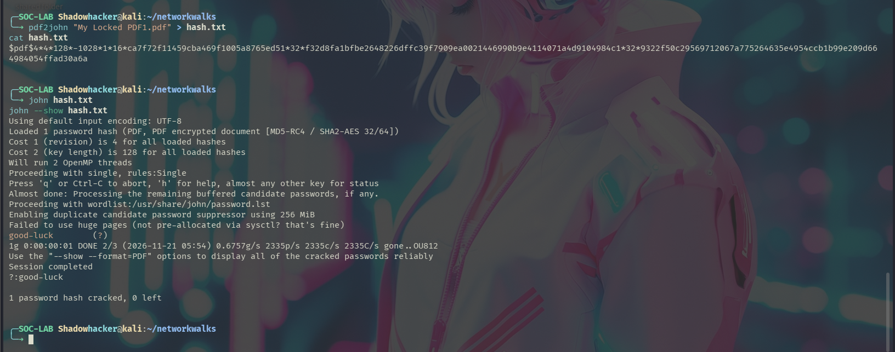
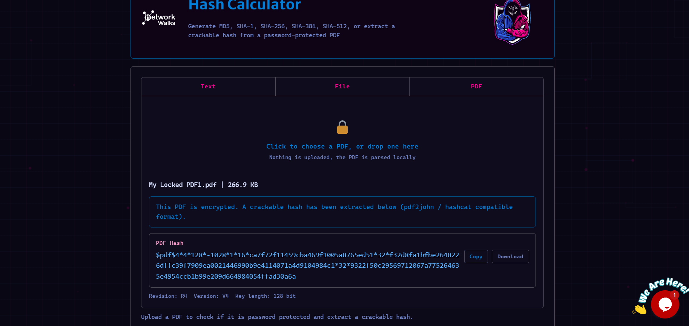
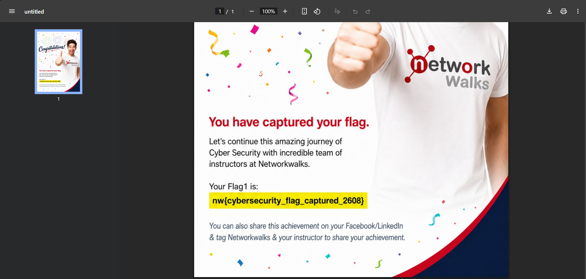
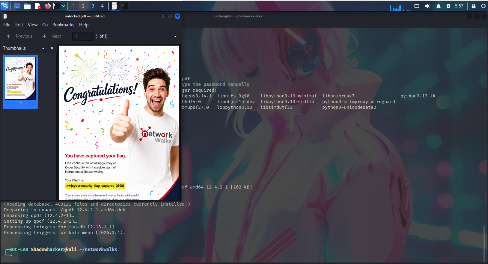

---

## PDF 2 — My Locked PDF2.pdf

**JTR (command line):**
```bash
pdf2john "My Locked PDF2.pdf" > hash1.txt
cat hash1.txt
john hash1.txt
john --show --format=PDF hash1.txt
```

| Evidence | File |
|---|---|
| Hash extraction + JTR crack in terminal | `evidence/pdf2-hashes.png` |
| NetworkWalks Hash Calculator extracting the same hash | `evidence/pdf2-hashes-networkwalk.png` |
| NetworkWalks Password Cracker result | `evidence/pdf2-passwordcracked.png` |
| Unlocked PDF content (flag captured) | `evidence/pdf2-evidence-ctf.png` |

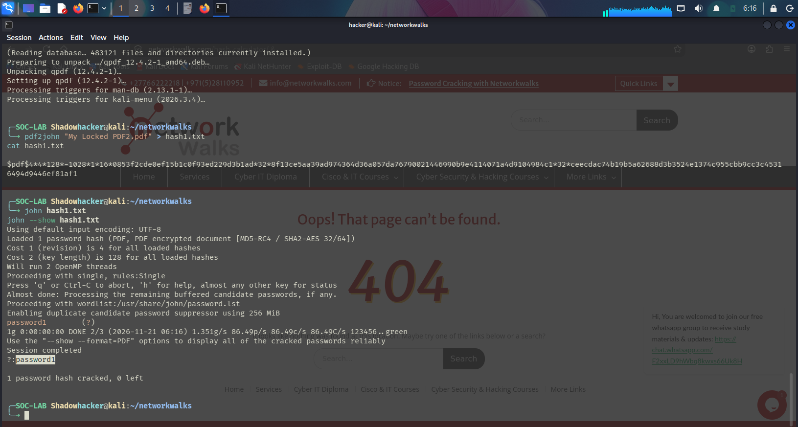
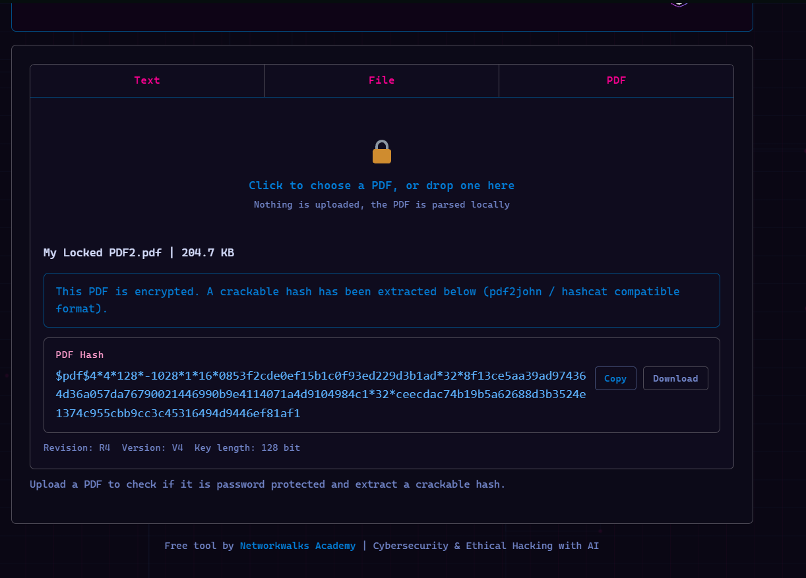
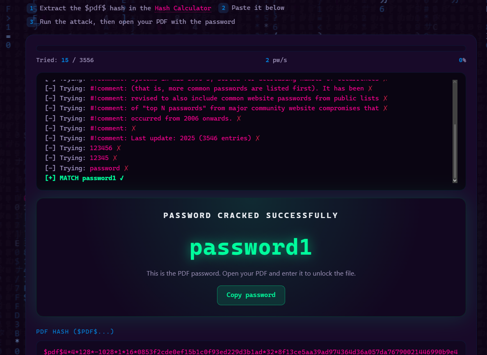
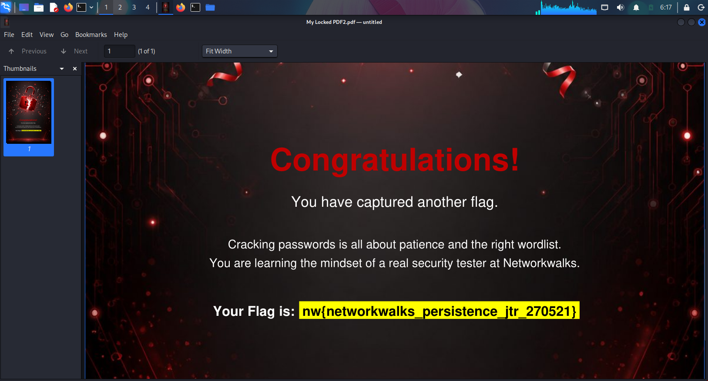

---

## PDF 3 — My Locked PDF3.pdf

**JTR (command line):**
```bash
pdf2john "My Locked PDF3.pdf" > hash2.txt
cat hash2.txt
john hash2.txt
john --show --format=PDF hash2.txt
```

| Evidence | File |
|---|---|
| Hash extraction + JTR crack in terminal | `evidence/pdf3-hashes.png` |
| NetworkWalks Hash Calculator extracting the same hash | `evidence/pdf3-hashes-networkwalk.png` |
| NetworkWalks Password Cracker result | `evidence/pdf3-passworkcracked.png` |
| Unlocked PDF content (flag captured) | `evidence/pdf3-evidence-ctf.png` |

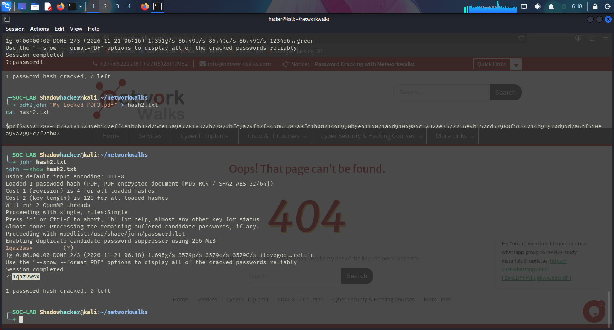
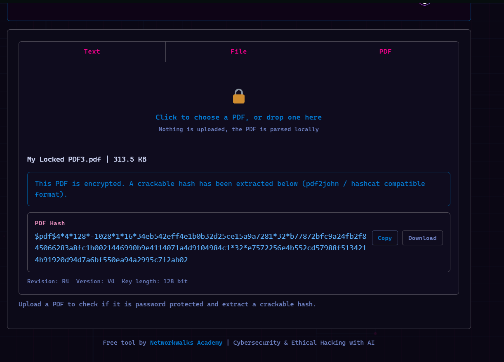
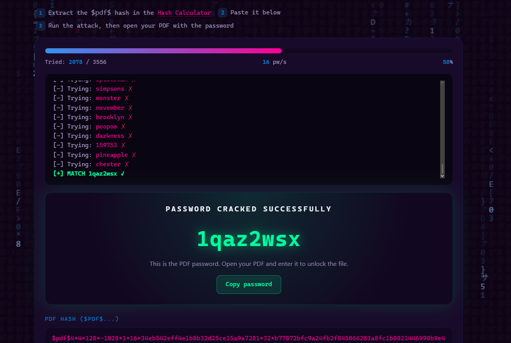
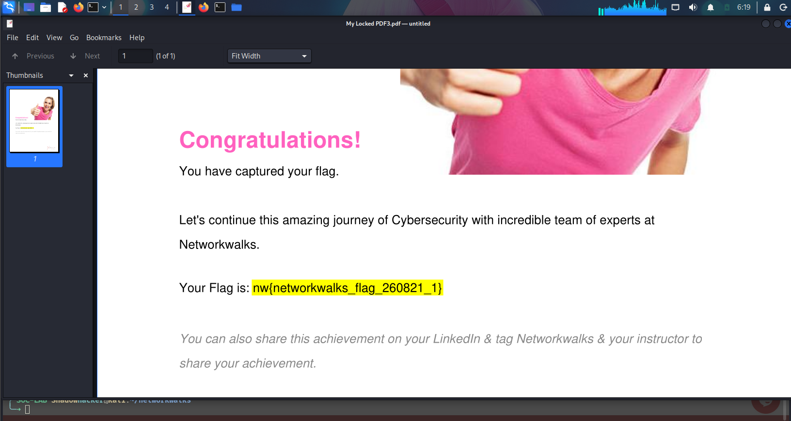

---

## Key Takeaway

A locked PDF's password is never stored in plain text — it's stored as a crackable hash. Extracting that hash (via `pdf2john` or the browser-based Hash Calculator) and running it through a dictionary/wordlist attack (`john` or the Password Cracker) recovers any password that exists in the wordlist. This is why weak, dictionary-based passwords are trivially recoverable, while long, random passphrases resist this attack entirely.

## Troubleshooting Log

- `pdf2john` initially failed with "pyhanko is missing" — Kali blocks unmanaged system-wide `pip install` (PEP 668 / externally-managed-environment). Resolved with:
  ```bash
  pip install --user --break-system-packages pyhanko
  ```
- The NetworkWalks Password Cracker's built-in word list didn't always contain the target password on the first try; resolved by uploading an extended custom wordlist where needed.
